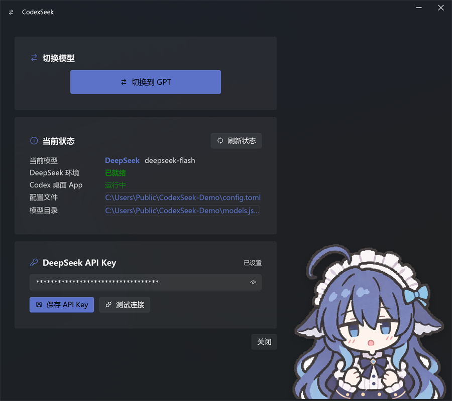
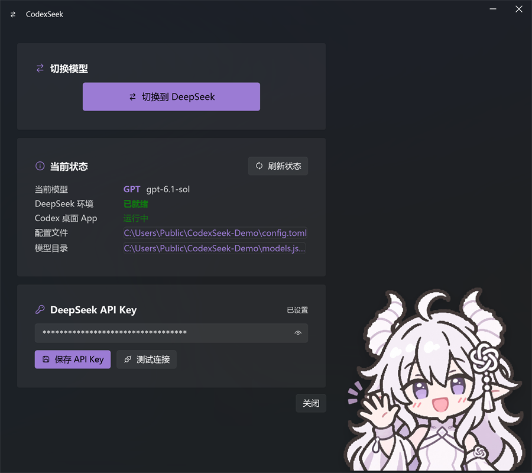
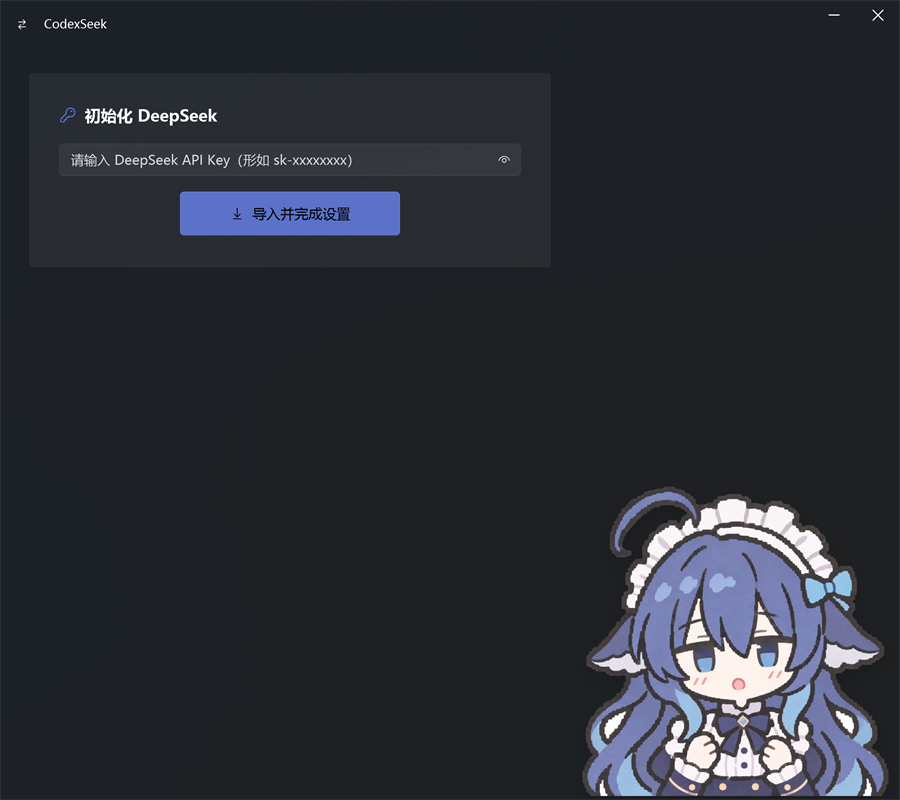

# CodexSeek

> 在 Windows 上为 Codex 桌面端一键切换 GPT / DeepSeek，并集中管理 DeepSeek API Key。

[](https://github.com/ThunderWe1/CodexSeek)
[](https://github.com/ThunderWe1/CodexSeek)
[](LICENSE)
[](https://github.com/ThunderWe1/CodexSeek/actions/workflows/build.yml)

CodexSeek 是一个原生 WPF 小工具。它把「修改 `%USERPROFILE%\.codex\config.toml` → 切换 provider → 注入模型目录 → 重启 Codex」这套手工流程做成一个窗口，让你在官方 GPT 模型和 DeepSeek 之间一键来回切换。

## 特性

- **一键切换**：在 `gpt-6.1-sol` 与 `deepseek-flash` 之间切换，无需手改 TOML。
- **API Key 管理**：导入 / 更新 DeepSeek Key，写入 `[model_providers.deepseek]` 的 `experimental_bearer_token`，并可调用 `/models` 做连通性测试。
- **首次使用引导**：自动创建 `config.toml` 与 `models.json`，检测环境是否就绪。
- **自动备份**：每次修改配置前生成 `config.toml.bak`，改坏了可以手动回滚。
- **进程感知**：检测 Codex 桌面 App 是否在运行，需要重启时先弹窗确认，避免悄悄中断任务。
- **原生轻量**：WPF + [WPF-UI](https://github.com/lepoco/wpfui)，Mica 背景、圆角窗口，不依赖 WebView2 / Node。
- **单文件分发**：自包含 win-x64 单文件 exe，目标机器无需安装 .NET。
- **内置自检**：`CodexSeek.exe --self-test` 可对配置读写逻辑做一轮无副作用的回归测试。

## 截图

<p align="center">
  
  
</p>
<p align="center">
  
</p>

> 角色图像来自 X 用户 [@798145343h](https://x.com/798145343h)。

## 下载

前往 [Releases](https://github.com/ThunderWe1/CodexSeek/releases) 下载最新的 `CodexSeek.exe`，双击运行即可。

- 系统：Windows 10 / 11（x64）
- 运行时：无额外依赖（.NET 8 运行时已打包进 exe）

> 第一次运行可能会被 SmartScreen 拦截（未签名程序），选择「更多信息 → 仍要运行」即可。

## 使用

1. **首次运行**：在「初始化 DeepSeek」卡片里粘贴 DeepSeek API Key（`sk-...`），点击「导入并完成设置」。程序会写入 provider 配置并切到 DeepSeek。
2. **日常切换**：在「切换模型」卡片点按钮，即可在 GPT / DeepSeek 之间切换；当前模型、Key 状态、配置路径会显示在「当前状态」里。
3. **Codex 正在运行**：切换前会提示「会先关闭并重启 Codex」，确认后继续；取消则不改配置。

### 配置文件位置

| 内容 | 路径 |
| --- | --- |
| Codex 配置 | `%USERPROFILE%\.codex\config.toml`（或 `%CODEX_HOME%` 指向的目录） |
| 模型目录 | `%USERPROFILE%\.codex\models.json` |
| 自动备份 | `config.toml.bak` |

## 从源码构建

需要 [.NET 8 SDK](https://dotnet.microsoft.com/download/dotnet/8.0)：

```powershell
dotnet publish src/CodexSeek/CodexSeek.csproj -c Release -o dist
```

产物为 `dist/CodexSeek.exe`（win-x64、自包含、单文件）。项目已配置 `PublishSingleFile` / `SelfContained`，直接 `dotnet publish` 即可。

### 自检

```powershell
.\dist\CodexSeek.exe --self-test
```

自检只在临时目录里读写配置，不会触碰真实的 `~/.codex`。

## 项目结构

```
src/CodexSeek/
├─ MainWindow.xaml(.cs)        # 主界面与交互
├─ Services/
│  ├─ CodexConfigService.cs    # config.toml / models.json 读写与切换逻辑
│  ├─ CodexDesktopService.cs   # Codex 桌面进程检测 / 停止 / 启动
│  ├─ CodexPaths.cs            # CODEX_HOME 解析
│  ├─ DeepSeekApiService.cs    # Key 连通性测试
│  ├─ SelfTest.cs              # --self-test 实现
│  └─ TomlDocument.cs          # 极简 TOML 读写
└─ Assets/                     # 图标、模型目录、看板娘插画
```

## 说明与免责声明

- 本项目与 OpenAI、DeepSeek 均无官方关联，"Codex" 为 OpenAI 的产品名称，这里仅用于说明用途。
- 程序会修改 Codex 的配置文件（并自动备份）以及重启 Codex 桌面 App，请自行评估风险。
- 使用 DeepSeek API 产生的费用和合规责任由使用者承担。
- 角色图像来自 X 用户 [@798145343h](https://x.com/798145343h)，版权归原作者所有；再分发前请确认授权。

## License

[MIT](LICENSE)
